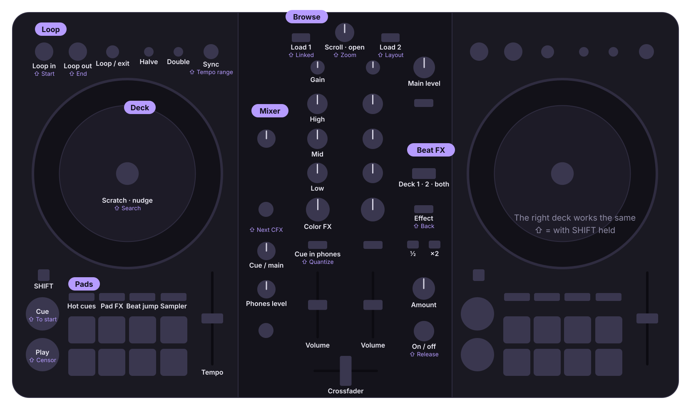

A two-deck controller from Pioneer DJ, and the one openDJ is tested with most.

## Get going

1. Plug the FLX4 in over USB. openDJ picks its mapping by itself.
2. In **Settings › Audio**, choose the DDJ-FLX4 as the sound card: main on
   channels 1-2, headphones on 3-4.
3. Turn **BROWSE** to a track, press **LOAD**, then **PLAY/PAUSE**. The deck
   on screen starts, and the FLX4's lights follow it.

:::tip[Try it in openDJ]
**Settings › Help › Tutorials › DDJ-FLX4** walks you through a first mix on
the controller, one control at a time.
:::

## Mix two tracks

- **BEAT SYNC** matches the tempo and beats to the other deck. Hold it to
  make that deck the master. See [Sync](../decks.md#sync-and-quantize).
- **TEMPO** up is slower, as on Pioneer gear.
- **The jog wheel**: the top of the platter scratches, the rim nudges the
  mix back in line.
- **CUE** under a channel fader sends that deck to your headphones;
  **HEADPHONES MIXING** blends it with the main mix.

## Loop

**4 BEAT/EXIT** loops 4 beats where the track is, and leaves the loop.
**‹** and **›** halve and double it. **LOOP IN** and **LOOP OUT** make a
loop of any length. See [Looping](../looping.md).

## Pads

The pad mode buttons open the deck's pad tab on screen, and the pads play
what's in it. With **SHIFT**, each button picks the mode printed under it.

| Button | Pads play | With SHIFT |
|---|---|---|
| **HOT CUE** | Hot cues | Keyboard |
| **PAD FX1** | Pad FX | Pad FX 2 |
| **BEAT JUMP** | Beat jump | Beat loop |
| **SAMPLER** | Sampler | Key shift |

Press **KEYBOARD** twice for the [stems pads](../stems.md#stems-pads).

## Effects

- **CFX** turns each channel's [Color FX](../fx.md#color-fx).
- **BEAT FX**: pick an effect with **FX SELECT** and a deck with
  **CH SELECT**, set **LEVEL/DEPTH**, then press **ON/OFF**.
  See [Beat FX](../fx.md#beat-fx).

More

- **Tempo direction**: turn on **Tempo fader direction** in
  **Settings › Decks** to make up faster.
- **Decks 3 and 4**: in the 4-Deck layout, click deck 3's number to move
  the left side to deck 3 (deck 4 for the right side). See
  [Layouts](../layouts.md#decks-3-and-4-on-a-two-deck-controller).
- **Stems and Sculpt**: when the mixer on screen shows **STEMS** or
  **SCULPT**, the EQ knobs follow it.
- **Windows**: quit rekordbox first. Only one app can use the FLX4 at a time.

[Every control, with and without SHIFT](../../controllers/pioneer-ddj-flx4.md).
Something not right? [Tell us](https://github.com/openwave-studio/opendj/issues/new?template=controller.yml).
